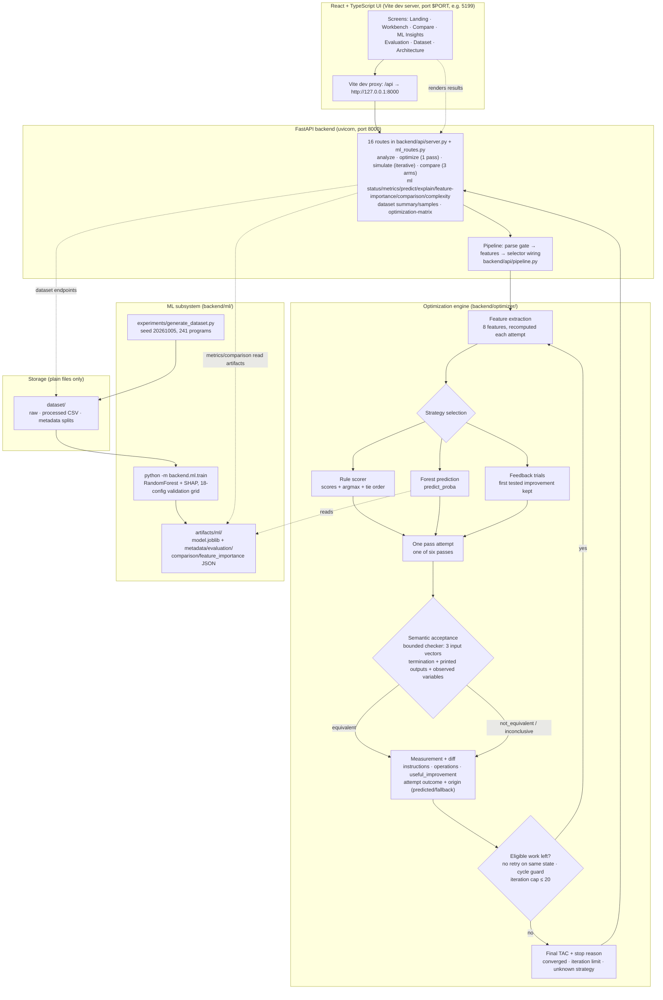

# Compiler Intelligence System

An academic project that takes **Three-Address Code (TAC)**, inspects its structure, decides which compiler optimization is most useful for that specific program, applies it under a semantic acceptance gate, and measures exactly how much the program improved — then compares a **Rule-Based selector** against a **trained Random Forest (ML) selector** on the same input, honestly and with reproducible numbers.

**Implemented today:** a FastAPI backend over a real TAC parser, an 8-feature extractor, six optimization passes, three selection modes (Rule-Based, ML, Feedback-Guided), a bounded iterative engine with controlled fallback and per-attempt semantic checking, a before/after diff and pass-accounting pipeline, a generated 241-program labelled dataset, a deterministic training/evaluation pipeline with SHAP explainability, and a React + TypeScript UI with seven screens. Everything documented in [Features](#4-features) is working code with tests behind it.

---

## Table of contents

1. [Overview and objectives](#1-overview-and-objectives)
2. [How it works (end-to-end workflow)](#2-how-it-works-end-to-end-workflow)
3. [Implemented vs. experimental status](#3-implemented-vs-experimental-status)
4. [Features](#4-features)
5. [System architecture](#5-system-architecture)
6. [Technology stack](#6-technology-stack)
7. [Repository structure](#7-repository-structure)
8. [Prerequisites](#8-prerequisites)
9. [Installation and setup](#9-installation-and-setup)
10. [Running the complete application](#10-running-the-complete-application)
11. [Usage tutorial](#11-usage-tutorial)
12. [Optimization examples](#12-optimization-examples)
13. [API reference](#13-api-reference)
14. [Dataset and ML setup](#14-dataset-and-ml-setup)
15. [Testing and verification](#15-testing-and-verification)
16. [Metrics and evaluation](#16-metrics-and-evaluation)

---

## 1. Overview and objectives

### The problem

Compiler optimization is usually taught and implemented as a fixed pipeline: passes run in a hardcoded order whether or not they help the program in front of them. Many passes only pay off when the code contains a specific opportunity (repeated expressions, dead assignments, constant-fed operations), so a fixed order wastes work, and — more importantly for a student project — nothing *measures* which pass actually helped.

### What this system does

1. **Parses** a TAC program into a small, explicit intermediate representation.
2. **Extracts measurable features** from that IR (how many constants, repeated expressions, dead statements, …).
3. **Selects a strategy** to try next, using one of:
   - **Rule-Based** — transparent, deterministic scores computed from the features;
   - **ML** — a trained `RandomForestClassifier` predicting the strategy from the same eight features, with `predict_proba` and SHAP explanations;
   - **Feedback-Guided** — the forest ranks candidates, each is *tested* on a copy of the program, and the first real improvement is kept (used inside the three-way comparison).
4. **Applies one pass**, verifies the result still *behaves* like the original program with a bounded semantic checker, and **rolls back** anything that fails.
5. **Measures** what changed (instructions, operations, work removed/remaining, diff, pass outcomes) and **iterates** until no eligible strategy remains, the iteration cap is hit, or the selector names something the engine does not have — always reporting which of those happened.
6. **Compares** Rule-Based vs ML (vs Feedback) side by side on the same original program: agreement, measured winner, correctness verdicts and runtimes.

### Why intelligent strategy selection is useful

- Opportunities differ per program: a loop-free constant-heavy snippet benefits from folding/propagation; a snippet with duplicated expressions benefits from CSE; dead-code-heavy input benefits from DCE.
- A learned selector can generalize which strategy tends to help which shape of program — and, just as valuably, the project *measures* when it does not (on the current held-out split, the rule-based selector wins — see [Metrics and evaluation](#16-metrics-and-evaluation)).
- Every decision is explainable: rules show their score computation, the forest shows probabilities, and SHAP shows per-feature contributions.

### Intended users and use cases

- **Faculty / students** demonstrating compiler optimization end to end (the original Streamlit demo in `app.py` still runs).
- **Coursework experimentation**: change a TAC program, watch which passes run, which were rejected, and why.
- **Selector research on a controlled corpus**: generated dataset with measured labels, grouped train/validation/test split, Rule-vs-ML prediction *and* execution comparisons.

### What is deliberately out of scope

No deep learning, no external benchmark datasets, no production claims, no formal verification..

---

## 2. How it works (end-to-end workflow)

```text
TAC input (typed, pasted, or via API request)
  → Parse gate            empty source or nothing parses → HTTP 400 with a readable message
  → Feature extraction    8 features, recomputed after every accepted change
  → Strategy selection    Rule-Based scores | Forest predict_proba | Feedback trials
  → Single pass attempt   the selector's prediction, or a ranked fallback once it had its chance
  → Semantic acceptance   bounded checker vs the original program on 3 deterministic input vectors;
                          unverifiable → rejected and rolled back
  → Measurement           instruction/operation reduction, useful_improvement, diff, pass outcome
  → Re-analysis           loop with cycle guard, no-retry-on-same-state, iteration cap ≤ 20
  → Stop (one of)         no eligible strategy left (converged) | iteration cap | unknown strategy
  → Results               final TAC, stop reason, pass history, diff, correctness verdict,
                          rule-vs-ml comparison (agreement, measured winner, runtimes)
```

Each **iteration** is exactly one executed pass attempt. A *selection round* can span several attempts: when the selector's prediction makes no useful improvement, the engine falls back to the rule-ranked next **eligible** strategy (one with a documented opportunity in the current program) and records that attempt separately (`origin: "fallback"`), so a recovery run never masquerades as the selector's own pick.

---

## 3. Implemented vs. experimental status

| Area | Status |
|---|---|
| TAC parser + IR, feature extraction, rule scorer | **Implemented and tested** |
| Six passes (Constant Folding, Constant Propagation, CSE, Dead Code, Algebraic) | **Implemented and tested** |
| Strength Reduction | **Implemented as a documented no-op** (never rewrites ) |
| Iterative engine, controlled fallback, cycle/iteration guards | **Implemented and tested** |
| Bounded semantic checker (interpreter-based acceptance) | **Implemented and tested** — evidence over tested inputs, not a proof |
| Diff, metrics, pass accounting, comparison payloads | **Implemented and tested** |
| FastAPI (16 routes), Swagger at `/docs` | **Implemented and tested** |
| Generated dataset (241 programs), deterministic grouped split | **Implemented, reproducible** |
| RandomForest selector + training/evaluation/SHAP pipeline | **Implemented** — model quality is preliminary (see [Metrics and evaluation](#16-metrics-and-evaluation)) |
| React UI (7 screens) | **Implemented** |
| Feedback-Guided selector | **Implemented engine-side and reachable through `/api/compare`**; the Workbench tab that posts `selector: "feedback"` to `/api/simulate` is rejected by the request schema (`422`) |
| Evaluation matrix + complexity analysis pages | **Implemented** (matrix cells are single-pass executions on independent copies) |
| Legacy React UI (`frontend/`), Streamlit demo (`app.py`) | **Present and runnable**, pre-dates the current UI |
| `examples/` directory | **Empty** |
| Charts infrastructure (`recharts`, `src/components/ui/chart.tsx`) | **Installed but unused by current screens** — pages render tables, matrices and CSS bar indicators |

---

## 4. Features

### 4.A TAC input and analysis

**Supported syntax** (`backend/tac/parser.py`):

```text
# comments and blank lines are skipped
t1 = 5                 # constant assignment
t2 = a + b             # binary: +  -  *  /  %
t3 = a % b             # modulo
t4 = -x                # unary minus
result = 42            # literal copy
L1:                    # label
goto L2                # unconditional jump
if x > 0 goto L1       # conditional jump (== != <= >= < >)
print result           # observable output (variable or literal: print 42)
```

**Parsing and validation**

- Lines are parsed individually; a line matching no pattern is dropped, so partially valid input still runs.
- Empty input → `400` `TAC source is empty.`
- Input where **no** line parses → `400` `No valid TAC instructions were parsed from the supplied source.`
- The API rejects unknown request fields (`extra="forbid"`), bounds `max_iterations` to 1–20, `selector` to `rule|ml`, and `top_k` to 1–8 (`422` otherwise).

**Intermediate representation** — `backend/tac/instruction.py` defines opcodes `assign, add, sub, mul, div, mod, const, label, goto, if, uminus, print` inside a `TAC` instruction list. Statements are the unit of counting; comments and blank lines never become instructions.

**Feature extraction** — `backend/features/extractor.py`, single source of truth (`FEATURE_KEYS`) shared by the generator, training, API and UI:

| Feature | Meaning |
|---|---|
| `num_statements` | number of parsed statements |
| `num_constants` | constant literal operands/assignments |
| `num_repeated_expr` | repeated (identical) expressions |
| `num_dead_stmts` | assignments whose result is never read (control-flow and `print` never counted dead) |
| `num_algebraic_ops` | identities such as `x + 0`, `x * 1` that the algebraic pass could rewrite |
| `num_loop_ops` | multiplication-by-constant / loop-ish patterns (input to strength-reduction scoring) |
| `num_tmp_vars` | `t<digits>` temporaries (named variables are not temporaries) |
| `const_ratio` | share of constant operands |

Features are recomputed **after every accepted transformation**, so each iteration's decision describes the program as it is *now*.

### 4.B Optimization strategies (the six passes)

Each pass rewrites the whole TAC in one call. Examples use the real dialect:

| Pass | What it actually does | Example |
|---|---|---|
| **Constant Folding** (`constant_folding.py`) | Folds binary instructions whose operands are **both literals**; refuses to fold literal division/modulo by zero. | `t1 = 5 + 3` → `t1 = 8`; `t7 = 100 - 40` → `t7 = 60` |
| **Constant Propagation** (`constant_propagation.py`) | Single forward pass with a *must* constant environment (redefinitions kill a binding, label boundaries stop propagation). Replaces constant-valued variable reads; when a replaced instruction then has two literals it folds once in the same pass. | `a = 10` , `p = a + 3` → `p = 13`; `f0 = 5 + 3` is left untouched (that is folding's job) |
| **Common Subexpression Elimination** (`common_subexpression.py`) | Re-executes no duplicate: a later identical expression is rebound to the earlier result. | `t1 = a + b` ; `t2 = a + b` → `t2 = t1` |
| **Dead Code Elimination** (`dead_code.py`) | Removes assignments whose result is never read afterwards; never removes control flow or `print`. | `unused1 = 999` removed when nothing reads `unused1` |
| **Algebraic Simplification** (`algebraic_simplification.py`) | A **fixed list** of identities only: `x + 0`, `x * 1`, `x - 0`, `x / 1`, `x * 0`. | `t5 = t3 * 1` → `t5 = t3`; `t6 = t5 + 0` → `t6 = t5` |
| **Strength Reduction** (`strength_reduction.py`) | **Documented no-op.** Without loop-carrying dependency information it always declines rather than applying unsafe rewrites, so it changes nothing and measures 0 everywhere. | — |

Verification note: constant folding is pinned to literal-only rewrites and constant propagation to variable-fed substitution by regression tests (`tests/test_fixes.py`, `tests/test_comparison_results.py`), so neither pass claims the other's work.

### 4.C Strategy selection

**Rule-Based selector** (`backend/scoring/rule_based.py`) — deterministic, no randomness:

- Computes one score per strategy from the extracted features, e.g. CSE `0.1 + 0.15 × num_repeated_expr`, DCE `0.1 + 0.15 × num_dead_stmts`, algebraic `0.1 + 0.1 × num_algebraic_ops`, propagation `0.1 + 0.15 × num_constants / num_statements`, folding from `const_ratio × num_statements`, strength reduction hard-capped at `0.2`.
- Scores are normalized to sum to ~1.0 for display.
- `select_strategy()` = argmax; ties broken by the canonical `STRATEGY_TIE_ORDER` (`constant_folding → constant_propagation → common_subexpression → dead_code_elimination → algebraic_simplification → strength_reduction`) — never random.
- `strategy_reason()` returns the human-readable rationale shown in the UI trace.

**ML selector** (`backend/ml/`):

- Model: `RandomForestClassifier`, `n_estimators=300`, seed `20261005`, trained on the **8 features only**.
- Input: exactly `FEATURE_KEYS` in the canonical order (a single source of truth prevents train/serve skew).
- Output: `predict()` strategy id plus rounded `predict_proba` per class (labelled in the UI as a *guess, not a guarantee*; probabilities are **not calibrated** — the payload says so).
- The model can only emit its five trained classes — `strength_reduction` has zero training labels, so it is reported as unsupported.
- **Training/loading/fallback** (`model.py`): artifacts cached module-level (keyed on file mtime+size, so retraining is picked up without restart); a missing or corrupt artifact is a first-class state:
  - read-only ML endpoints → `200` with `available: false` + `reason`;
  - endpoints that must *execute* an ML decision (`selector: "ml"`) → `503` `model_unavailable` with remedy `python -m backend.ml.train`.
  - The rule-based path is **never silently substituted** for a missing model.
- **SHAP explainability** (`explain.py`): `shap.TreeExplainer` contributions for the predicted class, base value, reconstruction check, feature values, and an explicit note that values are in probability space. If SHAP cannot produce contributions, `available: false` with a reason (never fabricated numbers).

**Predicted opportunities vs. actual improvements**

- The dataset label `best_strategy` is *measured*: all six passes are executed and the argmax of `useful_improvement` wins (ties → `STRATEGY_TIE_ORDER`). A prediction is compared against that label (**prediction quality**, macro-F1) — which is a different question from *how much work the chosen pass removed when executed* (**optimization effectiveness**, measured `useful_improvement`). `/api/ml/comparison` reports both separately and never merges them into one score.

**Selection → attempt → evaluation** (single source: `engine.py`):

1. `predicted = selector(current_tac)` — always executed so the trace can show whether the prediction helped.
2. If the prediction already had its chance on this exact program, the engine executes the rule-ranked next **eligible** strategy (eligibility = a documented opportunity scan: e.g. would folding fold at least one instruction?) — recorded as `origin: "fallback"`.
3. Every attempt lands in exactly one documented outcome: `applied_useful` (changed and removed measured work) · `applied_changed` (changed but removed no measured work — a neutral rewrite that may unlock a later pass) · `executed_no_change` · `rejected` (failed acceptance or would cycle) · `failed` (the pass raised) · `unsupported` (unknown strategy id).
4. The engine never "runs all six blindly": fallback candidates must each have a documented opportunity, and the prediction + executed strategy are stored separately.

**Feedback-Guided mode** (third arm of `/api/compare`): the forest ranks candidates by predicted probability, each candidate is tested on a copy of the current TAC, the first measurable improvement is kept, rejected candidates are not retried for the same state.

### 4.D Iterative optimization

`run_iterative_optimization()` in `backend/optimizer/engine.py`:

- **Loop:** extract features → score → select → execute **one** attempt → verify → measure → repeat.
- **Recalculation:** features, scores and eligible strategies are recomputed from the *input program of each attempt* (recorded in the attempt itself).
- **Counts:** instruction count = statements; operation count = instructions with opcode `add/sub/mul/div/mod/uminus`; `work_remaining = instructions + operations`.
- **Acceptance gate:** a changed candidate is applied only if `check_semantic_equivalence(original, candidate)` reports `equivalent` (when the *original* itself faults on the test vectors, acceptance falls back to comparing against the pre-pass program). Anything still unverifiable is `rejected`, rolled back, and the rejection reason is stored with the attempt.
- **Termination safeguards:**
  - a strategy is never retried while it produced no accepted change on the *same* program state;
  - an accepted transformation that would reproduce a previously visited program state is rejected (cycle guard);
  - `max_iterations` (default **20**, API range 1–20) bounds every run.
- **Honest stop reasons** (each reported, never conflated):
  - `no_further_useful_improvement` — every eligible strategy was tried on the final program without an accepted improvement (**converged**);
  - `no_instruction_reduction` — same exhaustion, but the last accepted change only removed operations (historical vocabulary kept because the UI reports it; **converged**);
  - `max_iterations_reached` — the safety cap ended a still-improving run (**not** converged);
  - `no_applicable_optimization` — the selector named a strategy id the engine does not have; the run stops without guessing (attempt recorded `unsupported`, **not** converged).
- **No-effect passes and rejects** are shown as what they are: the UI renders `executed_no_change` as "no change" (never "skipped"), rejects with the checker's actual finding, and labels fallback attempts as fallbacks.

### 4.E Comparison and reporting

`POST /api/compare` runs **three independent arms** from the byte-identical original program: `rule_based`, `ml` (needs the model; otherwise `available: false` with a reason), `feedback` (same). The payload contains:

- **Original program block** — lines, instruction count, operation count, `work_remaining`, the 8 features.
- **Per arm** — iterations trace (strategy chosen by which selector, `origin`, outcome, before/after counts, per-attempt diff), `final_lines`/`final_text`, measured pass metrics, `stop_reason` (`converged`-family vs `max_iterations_reached` vs `no_applicable_optimization`, rendered as CONVERGED / ITERATION LIMIT / …), `runtime_ms`, and a `correctness` block (`status`, `outputs_compared`, checked-vector evidence).
- **Before/after classification** — statements are classified `added (+)` / `removed (−)` / `modified (~, shown as one before → after row)` / `unchanged (no marker)`, with counts consistent with the backend diff (`diff.lines`); unchanged statements keep their original order in the rendered program.
- **Pass accounting** — *attempts* vs passes that actually *changed the code* (changed / no-effect / rejected / by-fallback), so a no-effect run is never counted as a transformation.
- **Work removed / work remaining** — the UI labels `useful_improvement` as **Work removed** and prints the formula (`instructions removed + operations removed`); **Work remaining** per arm = final instructions + final operations; the header's original work = `instructions + operations` of the input. Reduction % = instruction reduction ÷ original instructions × 100.
- **Agreement** — whether both selectors made the same choices, and the first iteration they diverged (`diverged_at_iteration`).
- **Winner** — decided **only** by measured `useful_improvement` among executed arms; equal outcomes → `winner: "tie"` with an explicit note (e.g. "Multiple selectors produced the same measured improvement."), `decided_by: "measured useful_improvement of all executed runs"`. If the model is missing, the payload still returns the full Rule-Based side and declares **no winner**.
- **Runtime** — `runtime_ms` is a **single wall-clock run** of that arm on the request-serving machine: no warm-up, no repeats, not a benchmark. The UI says "not measured" when a value is absent; the dedicated complexity endpoint (below) is the place repeated measurements exist.

**Correctness status vocabulary:** `equivalent` · `not_equivalent` · `inconclusive` (checker itself) and `not_run` for an arm that never executed. The UI renders `equivalent` as **VERIFIED** only when the checker actually passed it, `inconclusive` as **NOT CHECKED**, and always describes the verdict as *"tested-input evidence, not a proof"*.

### 4.F Correctness checking

Two pieces, both interpreter-based (`backend/tac/interpreter.py`, `backend/optimizer/correctness.py`):

**`execute_tac`** — a deterministic interpreter for the dialect:

- semantics for assignments, arithmetic, unary minus, comparisons, labels, `goto`/`if`, and `print` (the dialect's only output statement);
- deterministic inputs: any variable read without a definition gets `crc32(name#vector)`-derived values (stable across processes/platforms);
- faults are reported, not hidden: division/modulo by zero, unknown label, non-termination bounded by a **step limit of 100 000**;
- the sequence of printed values is recorded as the program's observable output.

**`check_semantic_equivalence(original, optimized)`** runs both programs on the same **3 deterministic input vectors** (`DEFAULT_INPUT_VECTORS = 3`) and requires, for every vector: both terminate within the step limit and agree on

1. the **printed output sequence**, and
2. the **final values of every variable the optimized program still reads** (operand reads plus `print` — anything no surviving instruction reads and no `print` emits cannot be observed).

It returns:

| Status | Meaning |
|---|---|
| `equivalent` | All checked vectors terminated and agreed on outputs and observed variables. **Bounded evidence, not a proof over all inputs** — the payload and the UI both say so. |
| `not_equivalent` | At least one checked vector disagrees (dropped/changed print, different termination, different observed value). |
| `inconclusive` | The check itself could not decide (e.g. the original faults on a vector while comparing against it, both runs hit the step limit without an observable difference, an unsupported opcode raised, or the checker raised). |
| `not_run` | (Comparison payloads) the arm never executed, so there is nothing to check. |

The engine runs this gate **per acceptance** (a pass that changes the program is applied only when the candidate verifies), and the comparison screen runs it on every executed arm. **Never** report or trust a "verified" claim unless this checker produced `equivalent` for that exact pair of programs.

### 4.G Pages and tools (React UI)

Seven routes in `src/App.tsx` (active UI workspace, see [Repository structure](#7-repository-structure)):

| Route / page | What it does |
|---|---|
| `/` **Landing** | Project introduction and links into the Workbench/Compare screens (no TAC editor here). |
| `/workbench` **Workbench** | TAC editor + scenario rail, selector tabs (Rule-Based / ML / Feedback-Guided ML / Compare All), "Optimize until no more improvements" run, per-iteration timeline with diff, decision trace (scores, prediction, rationale, outcome, origin), final counts. |
| `/compare` **Compare** | Rule vs ML (and feedback arm) on the same original: aligned panels with each arm's final TAC, `+0 / −N / ~N / unchanged` classification with legend, work-removed and work-remaining tiles, passes caption (attempts · changed · no-effect · rejected · by fallback), per-attempt log with selector attribution, stop-reason status tags, agreement, measured winner + honest tie note, runtime (single-run or "not measured"), and a correctness footer ("evidence, not a proof"). Single **Load Demo** button preloads an observable-output program. |
| `/insights` **ML Insights** | Model status/version/classes, native (impurity) vs SHAP feature importance kept distinct, per-prediction SHAP breakdown with reconstruction check and probability-space caveat, plus the **complexity analysis** section (theoretical `O(rules × features)` vs `O(trees × deepest tree)`, measured latency batches with median/min/max, artifact sizes, and labelled limitations from `GET /api/ml/complexity`). |
| `/evaluation` **Evaluation** | Held-out metrics per split (train/validation/test), per-class table, confusion matrix, corpus-level Rule-vs-ML comparison (`improved_pct` bars, program wins, winner) — and the **optimization technique matrix** (six techniques × dataset programs, paginated/searchable, from `GET /api/optimization-matrix`). |
| `/dataset` **Dataset** | Corpus summary, label distribution, per-category train/val/test split matrix (zero-test categories flagged), paginated searchable sample browser, detail panel with features, the six passes' measurements and live rule/ML selections. |
| `/architecture` **System Architecture** | Interactive diagram + eleven-component inventory with real file paths, the six passes (strength reduction declared a documented no-op), the request path of one `/api/compare` run, design principles and limitations — including that storage is `artifacts/ml/model.joblib` plus dataset CSVs: **no database, cloud service or queue anywhere**. |

Visualizations: screens render tables, matrices and CSS bar indicators; the iteration timeline (Workbench) and per-attempt log (Compare) are the "history" views. `recharts` and a chart primitive exist in the codebase but the current screens do not plot charts with them.

---

## 5. System architecture



**Component walkthrough**

1. **Frontend** (`.../artifacts/compiler-intelligence/src`) — typed API client `services/api.ts` issues same-origin `/api/*` requests; in development the Vite server proxies them verbatim to FastAPI (no rewrite), which is why CORS rarely comes into play locally. Each screen maps to one view component; the Workbench/Compare screens render the engine's recorded per-attempt data rather than recomputing anything client-side.
2. **API layer** (`backend/api/`) — `server.py` hosts the four original routes (`health/analyze/optimize/simulate`) with a strict Pydantic contract and CORS for localhost origins; `ml_routes.py` adds the ML, comparison, dataset and matrix routes. `pipeline.py` turns source text into parse → features → selector decisions; `serialize.py` renders TAC back to text; `dataset_service.py` / `matrix_service.py` read the CSVs (never the whole file at once).
3. **Engine** (`backend/optimizer/`) — one loop, pluggable selector (rule / ML / feedback callables), eligibility scans, per-attempt semantic gate, measurement (`measure.py`), diff (`diff.py`), and honest stop reasons.
4. **TAC layer** (`backend/tac/`) — instruction model, parser, and the interpreter that both the checker and tests ground truth on.
5. **ML subsystem** (`backend/ml/`) — deterministic generator-produced dataset → training → artifacts → prediction/explanation/evaluation/comparison readers. Nothing is trained at inference time.
6. **Storage** — `artifacts/ml/*` (model + JSON reports) and `dataset/*` (CSV/JSON). There is no database, message queue or cloud dependency.

**Data flow of one Compare run:** request → parse (same original for all arms) → each arm runs the engine independently (rule / ML / feedback selector) with per-attempt acceptance → measurement + diff + correctness per arm → agreement + winner computed from measured outcomes → response → side-by-side rendering.

---

## 6. Technology stack

| Layer | Technologies |
|---|---|
| Backend | Python 3.12 (3.10+ syntax), FastAPI, Pydantic, Uvicorn |
| Compiler core | Custom TAC parser/IR, custom deterministic interpreter, custom optimization passes — no third-party compiler framework |
| ML | scikit-learn (`RandomForestClassifier`), SHAP (`TreeExplainer`), NumPy, pandas, joblib |
| Dataset | Seeded generator (`experiments/`) writing CSV/JSON; pandas for validation |
| Frontend | React 19, TypeScript, Vite (Tailwind v4, Radix UI/shadcn primitives, lucide-react, react-router-dom 7; `recharts` installed) |
| Package management | pip (backend), **pnpm workspace** (frontend — npm is explicitly rejected by the workspace `preinstall` script) |
| Tests | pytest (+ pytest-cov, httpx for FastAPI's TestClient), Node-based render/integration verifiers |
| Legacy/demo | Streamlit + Plotly (`app.py`), older React UI (`frontend/`) |

---

## 7. Repository structure

```text
Compiler_Intelligence_System/            (git: https://github.com/yush08/Compiler_Intelligence_System.git)
├── backend/
│   ├── api/          FastAPI server, pipeline, serialization, dataset_service, matrix_service
│   ├── ml/           train · model · predict · explain · evaluate · compare · complexity · schemas
│   ├── tac/          instruction (IR), parser, interpreter
│   ├── features/     extractor — FEATURE_KEYS (single source of truth, 8 features)
│   ├── scoring/      rule_based — scores, select_strategy, STRATEGY_TIE_ORDER
│   ├── optimizations/ the six passes
│   └── optimizer/    engine (loop/fallback/acceptance), measure, diff, correctness
├── tests/            pytest suite (15 test modules + conftest.py) — see Testing
├── experiments/      corpus.py, generate_dataset.py (seeded), run_experiments.py
├── dataset/          raw/ · processed/ (241×46 CSV + JSON) · metadata/ (summary, splits, validation) · METHOD.md
├── artifacts/ml/     model.joblib + metadata/evaluation/comparison/feature_importance/
│                     confusion_matrix/classification_report JSON  (generated — never hand-edited)
├── report/data/      per_program.csv, results.json from experiments/run_experiments.py
├── frontend/         LEGACY React UI (npm, port5173, /api proxy, VITE_API_URL in .env)
├── examples/         (empty)
├── app.py            Streamlit demo dashboard (imports the backend directly, no REST layer)
├── requirements.txt  core Python dependencies (see Prerequisites for the ML extras)
└── README.md         this document

D:/PROJECTS/front/compiler/               EXTERNAL pnpm workspace — the ACTIVE Phase-3 UI
└── artifacts/compiler-intelligence/      src/views (7 screens), src/components, src/services/api.ts,
                                          verify-render.mjs, verify-integration.mjs, package.json
```

**Important:** the active UI lives in a **separate pnpm workspace outside this git repository** (it is not under version control in this environment, and `git clone` of the backend repo does **not** include it). The repository's own `frontend/` directory is the *legacy* UI. Commands below state their working directory explicitly.

Notes:

- `tests/` is run with pytest from the repository root.
- `.venv/`, `node_modules/`, `__pycache__/`, `.pytest_cache/` and `dist/` outputs are git-ignored; `artifacts/ml/` and `dataset/` are **tracked but generated** (regenerate them with `python -m backend.ml.train` / `python experiments/generate_dataset.py` — never hand-edit).
- Historical write-ups: `COMPLETION_REPORT.md`, `PHASE1_SUMMARY.txt`.

---

## 8. Prerequisites

Versions **verified in this environment** (older versions are untested — do not assume minimums):

| Tool | Verified version | Notes |
|---|---|---|
| Git | any recent | for cloning; `git --version` |
| Python | **3.12.5** (code uses `X \| Y` union syntax → 3.10+) | `python --version` |
| pip | bundled with Python | |
| Node.js | **v22.23.3** | `node --version` |
| pnpm | **12.9.1** | `pnpm --version`; install via `corepack enable` or the official installer |
| npm | bundled with Node | only for the **legacy** `frontend/` and nothing else |

**Python packages**

- `requirements.txt` contains exactly: `streamlit`, `plotly`, `fastapi`, `uvicorn`, `pydantic`, `pandas`, `pytest`, `pytest-cov`, `httpx` (NumPy arrives transitively via pandas/streamlit).
- The **ML subsystem additionally needs `scikit-learn`, `joblib` and `shap`**, which are **not** currently listed in `requirements.txt`. Without them:
  - `POST /api/optimize|/api/simulate` with `selector: "ml"` returns `503 model_unavailable`;
  - the full test suite fails at collection with `ModuleNotFoundError: No module named 'joblib'` (verified);
  - training/evaluation/SHAP are unavailable.
  Install them explicitly (see below). This is a documented gap in the manifest, not an invented dependency.

---

## 9. Installation and setup

### 9.1 Clone

```powershell
git clone https://github.com/yush08/Compiler_Intelligence_System.git
cd Compiler_Intelligence_System
```

```bash
git clone https://github.com/yush08/Compiler_Intelligence_System.git
cd Compiler_Intelligence_System
```

All backend commands below assume the **repository root** as the working directory (Python imports are `backend.*` modules resolved from here).

### 9.2 Backend setup

**Windows PowerShell**

```powershell
cd D:\path\to\Compiler_Intelligence_System
python -m venv .venv
.\.venv\Scripts\Activate.ps1
pip install -r requirements.txt
pip install scikit-learn joblib shap        # ML subsystem + full test suite (see Prerequisites)

python -m backend.ml.train                  # one-time: train the model (~30 s)
python -m uvicorn backend.api.server:app --host 127.0.0.1 --port 8000
```

**macOS / Linux**

```bash
cd /path/to/Compiler_Intelligence_System
python3 -m venv .venv
source .venv/bin/activate
pip install -r requirements.txt
pip install scikit-learn joblib shap

python -m backend.ml.train
python -m uvicorn backend.api.server:app --host 127.0.0.1 --port 8000
```

Verify:

- Health: <http://127.0.0.1:8000/api/health> → `{"status":"ok","system":"COMPILER INTELLIGENCE SYSTEM","mode":"rule-based","ready":true}`
- Swagger/OpenAPI UI: <http://127.0.0.1:8000/docs> (ReDoc at `/redoc`)

**Environment variables (backend): none.** The backend reads no environment variables — ports and paths are CLI arguments and constants.

### 9.3 Frontend setup (active UI)

The active UI is a **pnpm workspace member** — install from the workspace root (npm is rejected by the workspace `preinstall` script by design).

```powershell
cd D:\PROJECTS\front\compiler            # workspace root (contains pnpm-workspace.yaml + pnpm-lock.yaml)
pnpm install

cd artifacts\compiler-intelligence
$env:PORT = '5199'      # dev-server port (strict: the server exits if it is taken)
$env:BASE_PATH = '/'    # Vite base path — both variables are REQUIRED by vite.config.ts
pnpm dev
```

```bash
cd /path/to/front/compiler
pnpm install
cd artifacts/compiler-intelligence
PORT=5199 BASE_PATH=/ pnpm dev
```

Open <http://127.0.0.1:5199/> (use the port you set in `PORT`).

**How it connects:** the client calls same-origin `/api/...` paths; the Vite dev server proxies them **verbatim** to `http://127.0.0.1:8000` (`vite.config.ts`). There is no `VITE_API_URL` in the active UI (the `.env` with `VITE_API_URL` belongs to the legacy `frontend/`). CORS on the backend additionally allows any `localhost`/`127.0.0.1` origin, so direct cross-origin calls from local ports also work.

**Scripts** (in `artifacts/compiler-intelligence/package.json`):

| Script | Command | Purpose |
|---|---|---|
| `pnpm dev` | `vite --config vite.config.ts --host 0.0.0.0` | dev server on `$PORT`, `/api` proxy |
| `pnpm build` | `vite build` | production bundle → `dist/public` (**requires `PORT` + `BASE_PATH`**) |
| `pnpm typecheck` | `tsc -p tsconfig.json --noEmit` | TypeScript check |
| `pnpm serve` | `vite preview` | serve the production bundle on `$PORT` |

Workspace root also offers `pnpm build` (typecheck + recursive build) and `pnpm typecheck`.

### 9.4 Legacy UI and Streamlit (optional)

```powershell
# legacy React UI (in-repo, npm) — dev server on port5173, /api proxy → :8000,
# API base also read from frontend/.env (VITE_API_URL=http://localhost:8000)
cd frontend
npm install
npm run dev

# Streamlit demo (imports the backend directly, no REST API)
cd <repo root>
.\.venv\Scripts\Activate.ps1      # or your ML-capable interpreter
streamlit run app.py              # prints its local URL (default http://localhost:8501)
```

---

## 10. Running the complete application

Exact two-terminal procedure (three checks at the end):

1. **Terminal 1 — backend** (repository root, ML-capable environment):

   ```powershell
   cd D:\path\to\Compiler_Intelligence_System
   .\.venv\Scripts\Activate.ps1
   python -m uvicorn backend.api.server:app --host 127.0.0.1 --port 8000
   ```

   Wait for `Uvicorn running on http://127.0.0.1:8000`.

2. **Terminal 2 — frontend** (workspace, with `PORT`/`BASE_PATH` set):

   ```powershell
   cd D:\PROJECTS\front\compiler\artifacts\compiler-intelligence
   $env:PORT = '5199'; $env:BASE_PATH = '/'
   pnpm dev
   ```

3. **Verify connectivity:**

   - <http://127.0.0.1:8000/api/health> returns the JSON above (backend up).
   - <http://127.0.0.1:5199/> loads the UI (frontend up).
   - <http://127.0.0.1:5199/api/health> returns the same JSON **through the dev proxy** — this proves frontend → backend wiring end to end. (All three verified in this environment.)

4. **Use it:** open `/workbench`, paste TAC (or Load Demo on `/compare`), run a selector. If the page loads but runs fail with HTTP errors, run step 3's proxy check first.

**Diagnosing connection failures**

- Proxy check fails with `502`/`ECONNREFUSED` → backend not running or on another port. The dev proxy target is hard-coded to `127.0.0.1:8000`; if you must move the backend, start it with `--port` of your choice **and** update `server.proxy` in `vite.config.ts`, then restart `pnpm dev`.
- Page fails to start: `PORT environment variable is required` → set `PORT`/`BASE_PATH` exactly as shown.
- Calling the API from another origin (not localhost) → blocked by design; CORS allows only `localhost`/`127.0.0.1` origins.

---

## 11. Usage tutorial

A paste-ready program (14 statements) that exercises several passes and has observable output:

```text
t1 = 12
t2 = 3
t3 = t1 / t2
t4 = t1 / t2
t5 = t3 * 1
t6 = t5 + 0
t7 = 100 - 40
t8 = t7 / 2
t9 = t6 + t8
unused1 = 999
unused2 = t1 * 100
t10 = t9 + t2
print t9
print t10
```

**Verified expected output:** running this exact block through the project's own parser and interpreter (`backend.tac.parser.parse_tac` + `backend.tac.interpreter.execute_tac`) terminates without a fault and prints `34.0` and `37.0` — the integer answers 34 and 37 in the interpreter's float form. This was executed in this repository while writing the README, not assumed; for your own inputs, always read the printed-output evidence from the app's correctness block rather than expecting the numbers above.

Step by step:

1. **Enter or load TAC** — Workbench: paste into the editor or pick a scenario; Compare: use **Load Demo** or paste.
2. **Analyze** — `POST /api/analyze` (Workbench analysis panels) shows the extracted 8 features, the six rule scores, the rule-based selection with rationale, and (when trained) the forest's prediction with probabilities.
3. **Run Rule-Based** — selector tab *Rule-Based* → run to convergence. Watch the iteration timeline: each row is one attempt with its strategy, `origin` (predicted/fallback), outcome, before/after counts and diff.
4. **Run ML** — tab *ML* (requires `python -m backend.ml.train` once; otherwise a designed "model unavailable" state with the remedy command). Probabilities are labelled as a guess.
5. **Compare** — `/compare` or the *Compare All* tab: three arms from the same original program, agreement, measured winner (or an explicit `TIE`), per-arm correctness verdicts and single-run runtimes.
6. **Inspect history and diff** — per-attempt log with selector attribution; diff markers `−` removed, `~` modified (one before → after row), `+` added, unmarked unchanged; counts shown as `+N added −N removed ~N changed N unchanged`; passes caption splits attempts into changed / no-effect / rejected / by-fallback.
7. **Interpret statuses** —
   - correctness: `VERIFIED` only if the bounded checker returned `equivalent` (three tested input vectors — evidence, not proof); `NOT CHECKED` for inconclusive/not-run;
   - stop reason: `CONVERGED` (no eligible work left) vs `ITERATION LIMIT` (cap reached) vs failure/unknown-strategy;
   - metrics: **Work removed** = instructions removed + operations removed; **Work remaining** = final instructions + final operations; reduction % is instruction-based; runtimes are single runs on this machine.

---

## 12. Optimization examples

Each example matches the actual pass behavior (verified by the regression suite):

```text
--- Constant folding (literal operands only) ---
t1 = 5 + 3            →  t1 = 8
t7 = 100 - 40         →  t7 = 60
t6 = 20 + 22          →  t6 = 42        (folded)
t5 = t3 * 1           →  unchanged here (algebraic simplification's identity, not folding's)
x = 10 / 0            →  unchanged      (literal division by zero is refused, never folded)

--- Constant propagation (variable-fed) ---
a = 10
p = a + 3             →  p = 13         (propagated and folded because a replacement occurred)
f0 = 5 + 3            →  unchanged      (both operands already literal: folding's job)
a = 10 ; a = x ; b = a                (redefinition kills the binding — no stale values)

--- Common subexpression elimination ---
t1 = a + b
t2 = a + b            →  t2 = t1
t3 = a + b            →  t3 = t1

--- Dead code elimination ---
unused1 = 999         →  removed (never read)
print t9              →  never removed (observable output)
loop: goto loop       →  never removed (control flow)

--- Algebraic simplification (fixed identities only) ---
t5 = t3 * 1           →  t5 = t3
t6 = t5 + 0           →  t6 = t5
t7 = t8 - 0           →  t7 = t8
t9 = t8 / 1           →  t9 = t8
t0 = t8 * 0           →  t0 = 0        (via the x * 0 identity)

--- Strength reduction ---
(no rewrite — documented conservative no-op)
```

Programs with no opportunity (e.g. `x = y` / `z = x`) converge immediately with a truthful "nothing eligible" stop reason — no pass is run for show.

---

## 13. API reference

Base URL: `http://127.0.0.1:8000` · interactive docs: `/docs` · all bodies are JSON.

| Method | Path | Parameters / body | Purpose · important response fields |
|---|---|---|---|
| `GET` | `/api/health` | — | `status`, `system`, `mode`, `ready` |
| `POST` | `/api/analyze` | `{ "tac": "...", "strategy"?, "selector"?: "rule"\|"ml", "include_ml"? }` | Parse + analyze: `features`, `strategies` (6 scores), `selected_strategy` + rationale, `ml` prediction, `selection` metadata |
| `POST` | `/api/optimize` | same as analyze (+ `max_iterations` field, unused) | **Applies exactly one pass** (pinned `strategy` wins, else the selector's choice) and measures it: `tac` (result lines), `iterations` (1 entry), `final_result` (counts, reduction %, operation counts, `useful_improvement`, `diff`), `selector`, `ml` |
| `POST` | `/api/simulate` | `{ "tac", "selector"?: "rule"\|"ml", "max_iterations"?: 1–20, "include_shap"? }` | **Iterative run to a stop**: `iterations` = per-attempt trace (strategy, predicted vs selected, origin, outcome, counts, rationale, diff), `final_result` (final/original TAC, counts, `useful_improvement`, `stop_reason`, `converged`, `selector`); acceptance gate applied per attempt |
| `POST` | `/api/compare` | `{ "tac", "max_iterations"?: 1–20, "include_shap"? }` | Three arms `rule_based` / `ml` / `feedback` from one original: `original_*` block, per-arm traces + `final_lines` + measurements + `correctness` + `runtime_ms`, `agreement`, `winner` (`rule_based`\|`ml`\|`feedback`\|`tie`\|null), `winner_note`, `decided_by` |
| `GET` | `/api/ml/status` | — | `available`, `ready`, `model_version`, `model_type`, `trained_at`, `training_samples`, `feature_names`, `supported_classes`, `unsupported_classes`, `config`, `shap`, `reason` (file *name* only — no absolute paths) |
| `GET` | `/api/ml/metrics` | — | Persisted `evaluation` (per-split accuracy/macro-F1/weighted-F1, per-class), `confusion_matrix`, `classification_report`; `available:false`+`reason` if missing |
| `GET` | `/api/ml/comparison` | — | Held-out Rule vs ML: `prediction` (accuracy/macro-F1 per selector, per-class, disagreement count) **and** `optimization` (mean useful improvement, improved %, program wins, `overall_winner`), `per_program`, `methodology`, `limitations` |
| `GET` | `/api/ml/complexity` | — | `theoretical` (rule scorer `O(rules × features)`, forest `O(trees × deepest tree)` — parameters read from code/artifact), `measured` (latency batches median/min/max with sample counts, artifact sizes, tracemalloc), `limitations`. **Slow on purpose** — it benchmarks both selectors inside the request (can take tens of seconds to minutes) |
| `GET` | `/api/ml/feature-importance` | — | `native` (impurity decrease), `shap` (mean absolute), `comparison_note` — kept distinct, never merged |
| `POST` | `/api/ml/predict` | `{ "tac", "top_k"? }` | `predicted_strategy`, `probabilities` (6-dp), `probability_ranking`, `classes`, `feature_values`, `probabilities_calibrated`, `note`; degrades to `available:false` |
| `POST` | `/api/ml/explain` | `{ "tac", "top_k"?: 1–8 (default 8) }` | SHAP: `contributions`, `ranked_contributions`, `base_value`, `reconstructed_probability` vs `model_probability`, `predicted_class`, `probabilities`, `feature_values`, `note`/`summary`/`disclaimer`; independent flags `available` (SHAP produced values) and `model_available` (forest exists) |
| `GET` | `/api/dataset/summary` | — | Corpus stats, schema + feature definitions, label and category distributions, per-category train/val/test split coverage (**25** generation categories; zero-test categories flagged), quality checks |
| `GET` | `/api/dataset/samples` | query `page` (≥1), `size` (1–200), `q`, `split` (`train`\|`validation`\|`test`) | Paginated, searchable list — never the whole CSV: `items`, `total`, `page`, `pages`, `query`, `split_filter` |
| `GET` | `/api/dataset/samples/{sample_id}` | path id | One sample: features, all six passes' measurements, live rule/ML selections + measured outcomes; `404` if unknown |
| `GET` | `/api/optimization-matrix` | query `page` (≥1), `size` (1–50, default 10), `q`, `split` | Per-technique measurements: **each cell runs one pass on an independent copy of the program's original TAC** (never chained): `rows`, `strategies` (the six ids), `metric`, `data_source`, pagination (`page`/`size`/`pages`/`total`), `limitations` |

**Error policy**

| Case | Response |
|---|---|
| Read-only ML view without model/artifacts | `200` `{ "available": false, "reason": "… Run: python -m backend.ml.train" }` |
| `selector: "ml"` on `/api/optimize` or `/api/simulate` without a model | `503` `{ "code": "model_unavailable", "message", "selector", "remedy": "python -m backend.ml.train" }` |
| Empty / wholly unparsable TAC | `400` with the parse message |
| Invalid field, unknown body key, `selector` outside `rule\|ml` (e.g. `feedback`), `max_iterations` outside 1–20 | `422` (Pydantic validation) — this is how the Workbench's Feedback tab currently fails; see Limitations |
| Unexpected failure | `500` with a generic message (no paths or tracebacks) |

**Example request (PowerShell)**

```powershell
Invoke-RestMethod -Method Post -Uri http://127.0.0.1:8000/api/analyze `
  -ContentType 'application/json' `
  -Body (@{ tac = "t1 = 10`nt2 = 20`nt3 = t1 + t2`nt4 = t1 + t2`nt5 = t3 * 1`nt6 = 100`nt7 = t6 + 50`nunused = t7`nt8 = t3 * 2" } | ConvertTo-Json)
```

**Example request (bash/curl)**

```bash
curl -X POST http://127.0.0.1:8000/api/compare \
  -H 'content-type: application/json' \
  -d '{"tac":"t1 = 5 + 3\nt2 = t1 * 2\nprint t2"}'
```

---

## 14. Dataset and ML setup

### Where the data comes from

Everything is **generated locally by this repository** — no external dataset download is required or supported.

```powershell
cd D:\path\to\Compiler_Intelligence_System
python experiments/generate_dataset.py                            # full dataset → ./dataset
python experiments/generate_dataset.py --samples 20 --out .\dataset-smoke   # smoke run
```

- Seeded (`DATASET_SEED = 20261005`); re-running produces byte-identical files.
- `241` unique TAC programs across **25 generation categories** grouped into **27 families** (one family = one template).
- Labels (`best_strategy`) are **measured**: run all six passes, argmax of `useful_improvement`, ties → `STRATEGY_TIE_ORDER`. No hand-written labels.
- Validation: parse round-trip, non-negative counts, percentages in `[0,100]`, duplicate detection, label coverage, family-split integrity (report: `dataset/metadata/validation_report.json`).
- Deterministic **grouped split** by family (151 / 45 / 45 = 62.7 / 18.7 / 18.7 %; target was 70/15/15 — recorded honestly), stratified so all five labels appear in every split. Full method: `dataset/METHOD.md` + `splits.json`.

Layout:

```text
dataset/
├── raw/tac_programs.json                    programs + generation category/family
├── processed/optimization_dataset.csv       241 rows × 46 columns, 0 nulls (pandas-friendly)
├── processed/optimization_dataset.json      same records + schema hints
└── metadata/
    ├── summary.json                         label counts, distributions, feature ranges, coverage
    ├── validation_report.json               validation checks + warnings
    └── splits.json                          seed, method, counts, ratios, label coverage
```

Each row: the 8 features, all six passes' measurements (`<strategy>_instruction_reduction`, `<strategy>_reduction_percentage`, `<strategy>_operation_reduction`, `<strategy>_useful_improvement`), `best_strategy`, `has_opportunity`, generation category/family, and split.

Label distribution (measured, not assigned): dead_code_elimination 77 · constant_folding 54 · algebraic_simplification 39 · constant_propagation 35 · common_subexpression 34 · **strength_reduction 0** (the pass is a deliberate no-op; the generator records the zero and emits a validation warning instead of inventing wins).

### Training the model

```powershell
python -m backend.ml.train          # from the repo root, ML packages installed
```

- Deterministic: seed `20261005`, `n_estimators=300`, **18-config** grid selected on **validation macro-F1 only** (the test split is touched exactly once, at the end), final forest fitted on the training split only.
- Selected config (current artifact): `max_depth=8`, `min_samples_leaf=4`, no class weighting; `model_version = rf-v1-c80226c5cd00be28`.
- Writes seven artifacts to `artifacts/ml/`: `model.joblib`, `metadata.json`, `evaluation.json`, `feature_importance.json`, `comparison.json`, `confusion_matrix.json`, `classification_report.json`.
- Runtime: ~30 s on the reference machine; re-running is safe (same inputs → same model; the running server picks the new artifact up by mtime without restart).

### Evaluation and inspection

- Embedded in training; read live via `GET /api/ml/metrics`, `GET /api/ml/comparison`, `GET /api/ml/feature-importance` or the **Evaluation**/**ML Insights** pages.
- Current numbers (read from `artifacts/ml/` on 2026-10-20 — see [Metrics and evaluation](#16-metrics-and-evaluation) for the table and caveats).
- There is **no** standalone `evaluate` command; evaluation is part of training (`backend/ml/evaluate.py` provides `classification_metrics` / `aggregate_outcome` used there).

### Missing artifacts / dataset

| Missing | Behavior |
|---|---|
| `model.joblib` (or any JSON) | `GET /api/ml/status` and other reads → `200 available:false` + reason naming the file and `python -m backend.ml.train`; executing ML selector → `503` with remedy; UI shows designed empty states. Nothing is substituted |
| `dataset/*.csv` | dataset endpoints → `200 available:false` + reason (or `500` with generic message on summary); regenerate with the generator |
| Never | fabricated metrics, silently swapped rule-based results for ML, absolute paths leaked to the client |

---

## 15. Testing and verification

All commands verified in this environment (2026-10-20).

| Check | Directory | Command | Success looks like |
|---|---|---|---|
| Full backend suite | repo root | `python -m pytest tests -q` | last line `362 passed, 1 warning …` (a few minutes; includes one model training run). **Interpreter must have `scikit-learn`/`joblib`/`shap`** or 9 modules fail collection with `ModuleNotFoundError: No module named 'joblib'` |
| A single regression file | repo root | `python -m pytest tests/test_comparison_results.py -q` | `N passed` (e.g. diff pairing, CSE/dead-code/constant-prop/algebraic/multi-print, the 14-instruction example) |
| Engine robustness only | repo root | `python -m pytest tests/test_engine_fallback.py -q` | `N passed` (fallback attempts, rejected/crashing passes, cycle guard, iteration cap) |
| TypeScript check | `artifacts/compiler-intelligence` | `pnpm typecheck` | no output, exit code `0` |
| Production build | `artifacts/compiler-intelligence` | `$env:PORT='5199'; $env:BASE_PATH='/'; pnpm build` (bash: `PORT=5199 BASE_PATH=/ pnpm build`) | Vite prints `✓ built …`; output in `dist/public/assets/`. Chunk-size advisories are warnings, not failures. `PORT`/`BASE_PATH` are mandatory — the config throws without them |
| Render verification | `artifacts/compiler-intelligence` | `node verify-render.mjs` | ends with `RESULT: ALL_CHECKS_PASSED`, exit `0` (no servers needed; boots Vite in middleware mode) |
| Integration verification | `artifacts/compiler-intelligence` | `node verify-integration.mjs` | prints `PASS`/`FAIL` lines with no `FAIL`. **Requires the backend on `127.0.0.1:8000`,** and its source references this machine's absolute paths (`D:/PROJECTS/front/...`, `D:/PROJECTS/compiler/...`) — on other layouts the file paths must be adjusted |
| Live smoke of the API | any | `Invoke-RestMethod http://127.0.0.1:8000/api/health` | the health JSON |

**Suite coverage** (16 modules + `conftest.py`, whose session fixture trains the model once against the real `artifacts/ml/`):

- All six optimizations, feature extraction, rule-based scoring, parser/IR.
- Iterative optimizer: outcomes, fallback attribution, cycle/iteration guards, stop-reason honesty, per-attempt feature re-measurement, faculty-program battery with interpreter-established expected outputs (never hardcoded).
- Semantic preservation: interpreter semantics including `print`; the bounded checker (dropped print → `not_equivalent`, both-nonterminating → `inconclusive`, unsupported opcode → `inconclusive`); label-boundary regressions for propagation/CSE; per-pass × per-program preservation battery.
- Metric integrity: counting definitions (print counts as an instruction; comments/blank/malformed lines never do; constants and copies are not operations), the `useful_improvement = instructions + operations` identity, chained pass-history replay equal to the reported final TAC, runtimes excluding checker time, diff classification invariants, zero-reduction on identical input.
- Comparison integrity: same-original independent arms, per-arm availability (ML/feedback degrade without a model), winner/tie semantics, diff-count invariants.
- ML package: training determinism, prediction, SHAP explanation, evaluation, corpus comparison.
- Dataset generator + dataset service + optimization matrix + complexity report.
- API: all routes including error policy (`400`/`422`/`503`, `available:false` reads) via TestClient.

**Total: 362 tests** (verified 2026-10-20).

---

## 16. Metrics and evaluation

### Metric definitions (as implemented — `backend/optimizer/measure.py` and `diff.py`)

| Term | Definition |
|---|---|
| **Instruction count** | Number of parsed statements. `print` counts as an instruction; comments, blank lines and dropped unparsable lines never do |
| **Operation count** | Instructions whose opcode performs a runtime computation: `add sub mul div mod uminus`. Copies and literal definitions are *not* operations |
| **Work remaining** | `instruction count + operation count` — the work still needed to run the program |
| **Instruction reduction** | `before − after` statements (per pass or per run) |
| **Reduction %** | `instruction reduction ÷ original instructions × 100` (0 when the original is empty) |
| **Operation reduction** | `operations before − operations after` (may be negative if a pass swaps one operation for another) |
| **`useful_improvement` (UI: "Work removed")** | `work_remaining(before) − work_remaining(after)` = instructions removed + operations removed. This composite exists because five of six passes are one-in/one-out rewrites that remove work without removing statements |
| **Work remaining (UI, per arm)** | final instructions + final operations of that arm |
| **Pass attempts vs changes** | attempts = iterations (every executed pass attempt); *changed* = outcomes `applied_useful`/`applied_changed`; no-effect = `executed_no_change`; rejected = `rejected`; `by fallback` = `origin: "fallback"`. No-effect runs are never counted as transformations |
| **Runtime** | `runtime_ms` per compare arm = **one** wall-clock run on the request-serving machine (no warm-up/repeats). The complexity endpoint is the place with repeated batches (median/min/max, sample counts) — and it labels its own method as an in-request observation, not an isolated benchmark |
| **Winner** | Arm with the largest measured `useful_improvement` among executed arms; equal → `tie` (+ note). `decided_by: "measured useful_improvement of all executed runs"` |
| **Agreement** | Whether selectors made the same choices; `diverged_at_iteration` names the first difference |

### Dataset (verified)

- 241 rows × 46 columns, 0 nulls, 241 distinct programs; 25 categories, 27 families; splits 151/45/45 (62.7/18.7/18.7 %), all five labels in every split, test families never seen in training.
- Label distribution as in [§14](#14-dataset-and-ml-setup); `strength_reduction = 0` by construction.

### Model evaluation (current artifacts, read 2026-10-20)

Held-out metrics (n = 45 test programs from 5 unseen families; primary metric = macro-F1):

| Split | Accuracy | Macro-F1 | Weighted-F1 |
|---|---|---|---|
| Train (n=151, in-sample) | 1.0000 | 1.0000 | 1.0000 |
| Validation (n=45) | 0.4222 | 0.4306 | 0.3827 |
| **Test (n=45, touched once)** | **0.4444** | **0.4067** | **0.4200** |

Rule-Based selector on the *same* test programs: accuracy 0.6889, macro-F1 0.6104. The two selectors disagree on 13 of 45 programs.

Execution outcome on the test split (each selector's chosen pass applied once to an independent copy of the same original TAC):

| Selector | Mean `useful_improvement` | Programs improved | Program wins |
|---|---|---|---|
| Rule-Based | 2.289 | 23/45 (51.1 %) | **2** |
| ML | 2.267 | 21/45 (46.7 %) | 0 |
| — | — | ties | **42** → overall winner **rule_based** |

**How to reproduce:** `python -m backend.ml.train`, then `GET /api/ml/metrics` + `GET /api/ml/comparison` (or the Evaluation page). The train-split scores are in-sample (hyperparameters were chosen on validation, not test) — treat them as such. On this corpus and split the ML selector does **not** beat the rules; that result is reported, not hidden.

---
